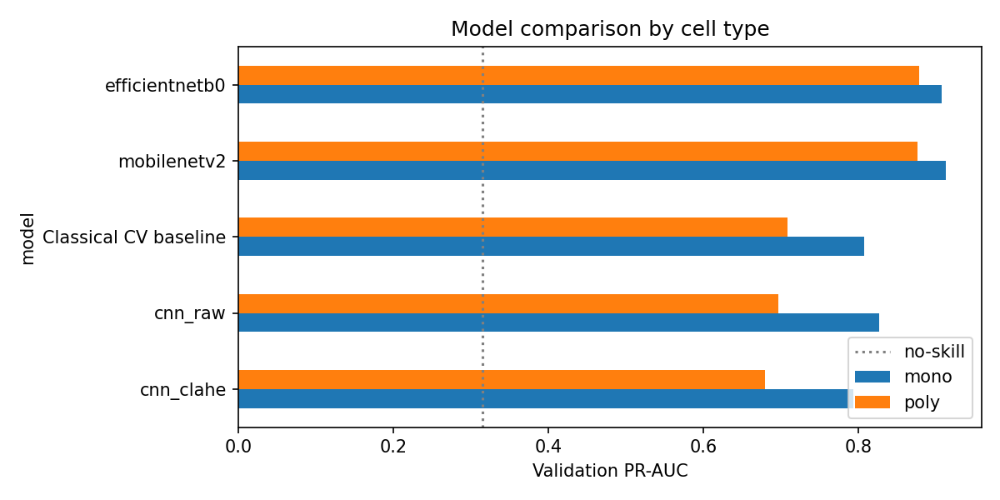
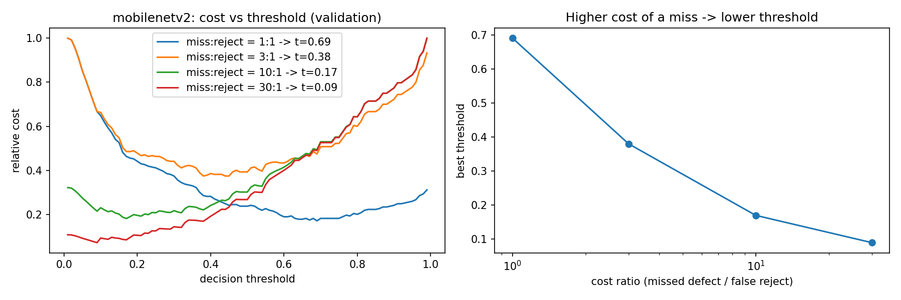

# Solar Cell EL Defect Inspection: Classical CV vs. CNN vs. Transfer Learning

Automated pass/fail inspection of photovoltaic cells from **electroluminescence (EL) images**, built as a quality-control decision system rather than a benchmark: models compared by missed defects and false rejects, evaluated separately per cell type, with the decision threshold set by business cost.

[](https://colab.research.google.com/github/OctaviaMay/elpv-solar-defect-inspection/blob/main/notebooks/03_transfer_learning.ipynb)

## Key result

On the held-out test set (394 cells, 123 defective), at the same **96.7% defect recall** (4 missed defects):

| Model | Test PR-AUC | Missed defects | False rejects |
|---|---|---|---|
| Classical CV baseline (OpenCV features + logistic regression) | 0.738 | 4 | 223 |
| **MobileNetV2 (transfer learning)** | **0.869** | **4** | **137** |

The transfer learning model catches the same defects with **39% fewer false rejects**, so fewer good cells are sent to re-inspection or downgraded.

## The problem

EL imaging reveals cracks and electrically inactive regions that are invisible to the eye. On a module line:

- a **missed defective cell** becomes a field failure, power loss or warranty claim;
- a **false reject** costs a re-inspection or a downgraded module.

The goal is not maximum accuracy. About 31% of cells are defective, so a model that always says "OK" would already score 69% accuracy. The goal is to **catch defects at the lowest false-reject rate**.

## Approach

| Step | Choice | Why |
|---|---|---|
| Data | 2,624 EL cell images (300×300, grayscale), mono and poly | public ELPV dataset |
| Labels | defective if expert defect probability ≥ 0.5 | the expert-uncertain 0.33 cells are labelled functional |
| Split | 70 / 15 / 15, stratified by **defect label × cell type** | equal defect rate and mono/poly mix in every split |
| Baseline 1 | OpenCV CLAHE + median filter, 8 hand-crafted features (black-hat morphology, dark-area fraction, Canny edges, Laplacian variance), logistic regression | a strong, explainable bar for deep learning to beat |
| Baseline 2 | small CNN from scratch, raw vs. CLAHE input | tests whether a CNN alone can beat the hand-crafted features |
| Transfer learning | MobileNetV2 and EfficientNetB0 (ImageNet), two-stage training: frozen backbone, then fine-tuning the top layers at a 100× lower learning rate with BatchNorm frozen | 1,836 training images is too few to train a deep network from scratch |
| Augmentation | flips and 90° rotations only | physically valid; brightness or contrast jitter could erase faint cracks |
| Imbalance | class weights | ~31% defective |
| Metrics | PR-AUC, recall on defects, missed defects, false rejects, overall and per cell type | accuracy hides missed defects |
| Threshold | chosen on validation by cost, then frozen for the test set | the test set is used exactly once |

## Results

### Model comparison (validation)

| Model | PR-AUC (all) | PR-AUC mono | PR-AUC poly | Inference | Model size |
|---|---|---|---|---|---|
| CNN from scratch (CLAHE input) | 0.710 | 0.793 | 0.680 | | |
| Classical CV baseline | 0.744 | 0.808 | 0.709 | | |
| CNN from scratch (raw input) | 0.747 | 0.827 | 0.697 | | |
| EfficientNetB0 | 0.892 | 0.908 | 0.879 | 9.4 ms/cell | 38.3 MB |
| **MobileNetV2** | **0.893** | **0.913** | 0.876 | **6.2 ms/cell** | **23.0 MB** |

Inference measured on a Colab T4 GPU, one cell at a time.



**Findings**

1. **The classical baseline is hard to beat without pretraining.** A CNN trained from scratch on 1,836 images only matches it (0.747 vs. 0.744). The hand-crafted features encode domain knowledge that the CNN has to learn from limited data.
2. **Transfer learning is the step change:** validation PR-AUC rises from about 0.74 to 0.89.
3. **It closes the poly gap.** Polycrystalline grain texture confuses the hand-crafted features (test PR-AUC 0.785 mono vs. 0.709 poly). MobileNetV2 performs almost equally on both (0.879 vs. 0.863).
4. **MobileNetV2 was selected over EfficientNetB0.** Accuracy is tied (0.893 vs. 0.892), but MobileNetV2 is about 1.5× faster and 40% smaller, which matters for deployment at an inspection station.
5. **CLAHE helps hand-crafted features but not the CNN.** The from-scratch CNN did better on raw images (validation 0.747 vs. 0.710, test 0.728 vs. 0.668). Each variant was trained once, so this is indicative rather than conclusive.

### Decision threshold set by business cost

The default threshold of 0.5 is arbitrary. The threshold was chosen to minimise
`cost = 10 × missed defects + 1 × false rejects` on the validation set, giving **t = 0.17**. The ratio is a business assumption, and the plot shows how the optimal threshold moves with it (from 0.69 at 1:1 to 0.09 at 30:1).



### Final test-set evaluation (run once)

Each model uses its own cost-optimal threshold chosen on validation.

| Model | Threshold | PR-AUC | Recall on defects | Precision | Missed defects | False rejects |
|---|---|---|---|---|---|---|
| CNN from scratch (CLAHE) | 0.43 | 0.668 | 0.967 | 0.325 | 4 | 247 |
| CNN from scratch (raw) | 0.15 | 0.728 | 0.951 | 0.367 | 6 | 202 |
| Classical CV baseline | 0.12 | 0.738 | 0.967 | 0.348 | 4 | 223 |
| **MobileNetV2** | **0.17** | **0.869** | **0.967** | **0.465** | **4** | **137** |

Test PR-AUC (0.869) is slightly below validation (0.893), the expected gap when every decision was made on validation.

## Repository

```
notebooks/
  01_eda_and_baselines.ipynb    data audit, stratified split, OpenCV preprocessing, classical CV baseline
  02_model_experiments.ipynb    small CNN from scratch: raw vs. CLAHE input
  03_transfer_learning.ipynb    MobileNetV2 vs. EfficientNetB0, model comparison, cost-based threshold, test evaluation
outputs/
  splits.csv                    the exact train / val / test split
  eval_*.csv                    validation and test metrics for every model
  best_model.keras              selected MobileNetV2 model
  best_model_config.json        training settings, threshold and test metrics
reports/figures/                figures used in this README
```

## Run it

```bash
pip install -r requirements.txt
```

Run the notebooks in order (01 → 02 → 03). Each one downloads the dataset if it is missing. Training needs a GPU: on a Colab T4, MobileNetV2 trains in about 3 minutes and EfficientNetB0 in about 5.

## Limitations and next steps

- **Explainability:** add Grad-CAM to check the model attends to cracks and inactive regions, not busbars or grain boundaries.
- **Error analysis:** inspect the remaining false rejects, especially the expert-uncertain 0.33 cells, and evaluate a manual-review band between auto-pass and auto-fail.
- **Drift:** train on mono cells only and test on poly to simulate a line switching cell type; monitor score drift (PSI) without labels.
- **Robustness:** repeat training over several seeds and report mean ± std, since each model was trained once.
- **Deployment:** TFLite / int8 export with an accuracy vs. latency comparison, served behind a REST endpoint.
- **Localisation:** pixel-level defect segmentation on an EL dataset with ground-truth masks.
- The 10:1 cost ratio is an assumption. In production it would come from quality and finance data.

The same pipeline (imaging → defect classification → cost-based threshold → per-group evaluation) transfers directly to wafer, die and package inspection.

## Data

ELPV dataset: 2,624 EL images of mono- and polycrystalline solar cells with expert defect probabilities. The images are licensed **CC BY-NC-SA 4.0** and are not redistributed here; the notebooks download them from the [official repository](https://github.com/zae-bayern/elpv-dataset).

> Buerhop-Lutz, C., Deitsch, S., Maier, A., Gallwitz, F., Berger, S., Doll, B., Hauch, J., Camus, C., Brabec, C. J. *A Benchmark for Visual Identification of Defective Solar Cells in Electroluminescence Imagery.* 35th European Photovoltaic Solar Energy Conference and Exhibition, 2018, pp. 1287–1289.
